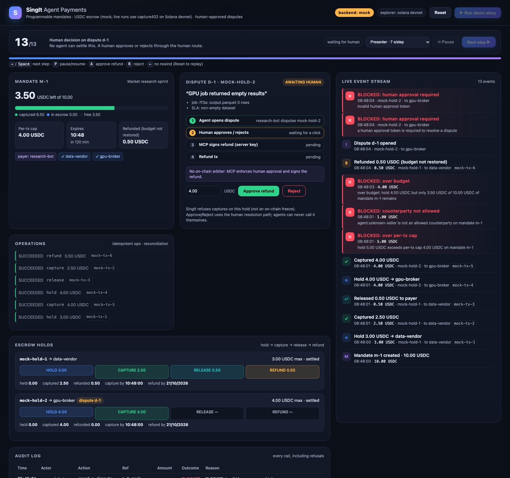
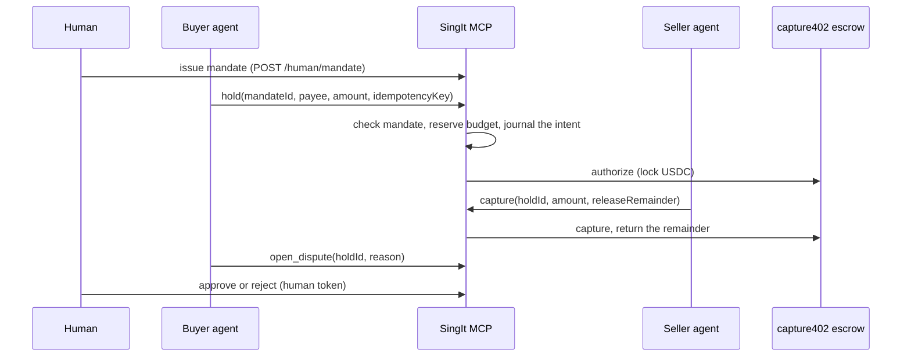

# SingIt Agent Pay

**Agents that pay each other, under human-set limits.** SingIt Agent Pay is an MCP server that lets AI agents pay each other in USDC through escrow. A human sets the mandate (budget, per-transaction cap, allowed payees, expiry). The buyer agent locks funds; the seller agent captures what the work actually cost; the rest goes back. Only a human can settle a dispute, and every action, including every refused one, lands in an audit log.

Built at FinTechers Prague, Track 2 "Agents that pay each other", 19–20 October 2026. Escrow runs on [capture402](https://github.com/starPaw/capture402-solana) on Solana devnet, with a mock backend for local demos.



## Status

| What | State |
|---|---|
| Demo on the mock backend (default) | Runs anywhere, no keys or network. All offline gates pass ([release gate](docs/RELEASE-GATE.md)) |
| Capture402 devnet backend | Implemented against the pinned public ABI and tested offline. Earlier scripted devnet runs on older revisions finalized 4/4 direct operations and 13/13 dashboard → MCP → devnet steps (historical, see [#14](https://github.com/bubon-ik/singit-agent-pay/issues/14)) |
| Real LLM agent paying on devnet (MVP-07) | Not run yet |
| Live devnet Go/No-Go | **NO-GO** until that run is accepted; mock demo **GO**, labeled MOCK ([release gate](docs/RELEASE-GATE.md)) |

Solana devnet and devnet USDC only, never mainnet. Experimental and not audited.

## Why

An agent with a wallet can overspend, pay the wrong party, pay twice after a timeout, or approve its own refund. SingIt puts deterministic rules between the agent and the money:

- **Mandates:** total budget, per-transaction cap, allowed counterparties, expiry and devnet-USDC mint pinning, checked before any transaction is built.
- **Escrow, not transfers:** `hold` locks funds; the seller captures part or all; the remainder is released back into the budget.
- **Roles from the transport:** each agent connects with its own bearer token. The buyer cannot capture, the seller cannot spend, and neither can issue itself a bigger mandate.
- **A human in the loop:** mandates are issued and disputes resolved only through a human route, with an HMAC approval token bound to the exact decision. No MCP tool can produce one.
- **Audit everything:** every call and every refusal, with a stable code.

## How it works



The policy runs in the service; the money rules run on-chain. The capture402 program fixes the hold maximum and deadlines, and the payer can reclaim an unused hold after the capture deadline without the seller. A dispute is a rule of this service, not an on-chain freeze. See [docs/ARCHITECTURE.md](docs/ARCHITECTURE.md).

## Payment safety

The agreed narrow workflow and ordered acceptance gates are in
[MVP-SCENARIO.md](docs/MVP-SCENARIO.md). Journal compatibility and read-only
diagnosis when startup refuses are documented in [JOURNAL.md](docs/JOURNAL.md).

Payments fail in messy ways: lost responses, timeouts, crashes between "sent" and "saved". The server is built so that none of these turns into a second payment.

- **One intent, one operation.** Every write carries an `idempotencyKey`, which is required on devnet. A retry with the same key returns the original result and `operationId`, even after a full capture or a passed deadline. Two identical requests at once still send only once.
- **UNKNOWN is never guessed.** If the outcome of a send is unproven, the reservation is kept, the server stops accepting new payments, and only the original transaction can settle it. No new salt, no resend, no automatic compensation.
- **Durable journal first.** The reservation and its intent are journaled before anything is signed; a failed disk write means nothing is sent. On devnet, startup restores the journal and reconciles read-only before serving.
- **Fail closed.** UNKNOWN, a failed journal write or shutdown closes economic writes. `GET /ready` reports why; `GET /health` only reports that the process is alive.
- **One runtime per set of wallets.** A second server with the same program, payer and merchant refuses to start, even with another state directory.

Details: [docs/INTERFACE.md](docs/INTERFACE.md) ("Live safety policy", "Operation journal").

## Quickstart (mock, no keys)

Requires Node 20, 22 or 24 (`.nvmrc` pins 22) on macOS or Linux.

```sh
npm ci
npm run demo:all
```

Open http://127.0.0.1:5173 and press **▶ Run demo story**. In 13 steps a research agent buys from two sellers. Three bad payments are blocked: over the per-transaction cap, to an unknown seller, and over budget. The agent's attempt to approve its own refund is refused, and the story waits for a human to decide the dispute. Step by step: [docs/DEMO.md](docs/DEMO.md). `npm run demo` plays the same story in the terminal.

| URL | What |
|---|---|
| http://127.0.0.1:8787/mcp | MCP, streamable HTTP |
| http://127.0.0.1:8787/health | liveness |
| http://127.0.0.1:8787/ready | economic readiness (open on mock; human route secret on devnet) |
| http://127.0.0.1:8787/api/state | read-only public state |
| http://127.0.0.1:5173 | demo dashboard |

On first run `demo:all` writes random local secrets to `singit-mcp/.env.local` (gitignored).

## Connect an agent

Start the server (`npm run demo:all`, or `npm run start:http` for the server only) and point an MCP client at `http://127.0.0.1:8787/mcp`.

On the mock backend without tokens, `/mcp` is open for local experiments. With agent tokens configured, as on devnet, each agent connects with its own token and the server derives its role from it:

```sh
# Claude Code as the buyer agent
claude mcp add --transport http singit-buyer http://127.0.0.1:8787/mcp \
  --header "Authorization: Bearer $SINGIT_BUYER_TOKEN"
```

```jsonc
// Cursor: .cursor/mcp.json
{ "mcpServers": { "singit-buyer": { "url": "http://127.0.0.1:8787/mcp", "headers": { "Authorization": "Bearer <buyer token>" } } } }
```

For stdio, the process environment fixes the role: `SINGIT_MCP_PRINCIPAL=buyer` or `merchant`, required on devnet. Never put the human secrets, keypairs or RPC credentials in an agent's config.

### Tools

Amounts are USDC base units as decimal strings (`2500000` = 2.5 USDC); times are Unix seconds. **`hold` is the pay tool.**

| Tool | Who | What it does |
|---|---|---|
| `hold` | buyer | Lock up to `amount` for an allowed payee under a mandate |
| `capture` | seller | Capture part or all of a hold; `releaseRemainder` returns the rest in the same call |
| `release` | seller | Return everything still held to the payer |
| `refund` | seller | Refund captured funds from the seller's own balance (does not restore budget) |
| `open_dispute` | buyer | Dispute a hold; the service then refuses captures until a human decides |
| `resolve_dispute` | human | Refund or reject, only with a human approval token |
| `create_mandate` | human | Issue a mandate (agents are refused; humans use `POST /human/mandate`) |
| `get_mandate`, `list_mandates` | own | A mandate with its remaining budget and holds |
| `list_disputes` | own | Disputes by status or mandate |
| `get_operation` | own | Redacted status of one payment by `operationId`, after a lost response or UNKNOWN |
| `list_audit_log` | own | Every action and refusal on the caller's mandates |

"Own" means the caller sees only mandates where it is the payer or an allowed payee. Economic writes accept `idempotencyKey` and return `operationId` and `replay`. Refusals come back as `{ok: false, code, reason, operationId?}`. Schemas and refusal codes: [docs/INTERFACE.md](docs/INTERFACE.md).

## Devnet (operators)

```sh
npm run live:all -- /absolute/path/to/private/devnet.env
```

This needs throwaway devnet wallets with devnet USDC and SOL, an approved HTTPS RPC, the confirmed program values, a private state directory, both human secrets and both agent tokens. The template is `singit-mcp/.env.example`. Live mode never falls back to mock. A live run also needs a GO in the release gate and the owner's separate authorization.

- [docs/LIVE-DEMO.md](docs/LIVE-DEMO.md): wallet roles, startup recovery, private state
- [docs/RUNBOOK.md](docs/RUNBOOK.md): caps, start and stop, what to do on UNKNOWN, buyer recovery
- [docs/CAPTURE402-DEVNET.md](docs/CAPTURE402-DEVNET.md): ABI pin, deployment identity, funding estimates

## Tests

```sh
npm test            # singit-mcp suites, then the dashboard e2e
npm run typecheck
```

The suites cover the mandate rules, the MCP transport with real clients, trusted principals, idempotent replay, concurrent and lost requests, crash boundaries, storage failures and the backend contract. The devnet contract suite is skipped without devnet configuration. Current results and the fault matrix: [docs/RELEASE-GATE.md](docs/RELEASE-GATE.md).

## Repository

| Path | What |
|---|---|
| `singit-mcp/` | MCP server: `PaymentService` (mandates, journal, reconciliation), transports, principals, human approval, mock and Capture402 backends, tests |
| `demo-dashboard/` | Web dashboard that plays the story against the MCP server; human console for disputes |
| `docs/` | [Architecture](docs/ARCHITECTURE.md), [interface](docs/INTERFACE.md), [demo story](docs/DEMO.md), [live demo](docs/LIVE-DEMO.md), [devnet backend](docs/CAPTURE402-DEVNET.md), [release gate](docs/RELEASE-GATE.md), [runbook](docs/RUNBOOK.md) |

Contributing rules (secrets, live authorization, no retries after UNKNOWN): [CONTRIBUTING.md](CONTRIBUTING.md).

## Built during the hackathon

Everything in this repository was written during the event. The first commit is tagged `hackathon-start`.

- MCP server over stdio and streamable HTTP, 12 tools
- Mandate engine and escrow lifecycle over a pluggable `PaymentBackend` (mock and capture402 devnet)
- Trusted principals per agent, human-only mandates and dispute decisions
- Durable operation journal, idempotent replay, UNKNOWN handling, fail-closed admission and readiness
- Audit log, demo dashboard, backend conformance suite, release gate and runbook

## Pre-existing (reused, not judged)

- **SingIt:** [singitai.app](https://singitai.app), [github.com/bubon-ik/SingItAI](https://github.com/bubon-ik/SingItAI). The team's existing product and x402 API; not part of this repository.
- **capture402 escrow:** [starPaw/capture402-solana](https://github.com/starPaw/capture402-solana), the Solana auth/capture escrow program the devnet backend targets. First published 19 October 2026, 10:46 CEST, before the 12:00 kickoff. Not part of this repository.

## License

[Apache-2.0](LICENSE), same as capture402. Third-party notices: [NOTICE](NOTICE).
