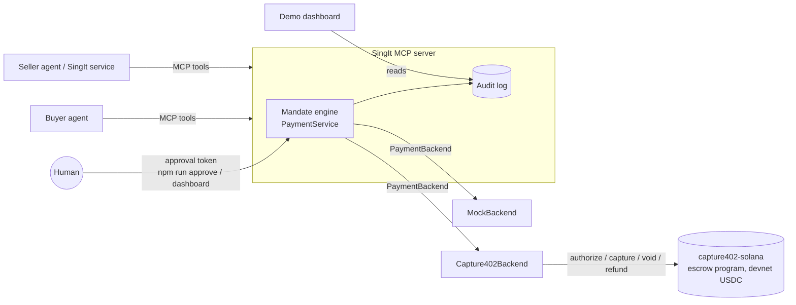
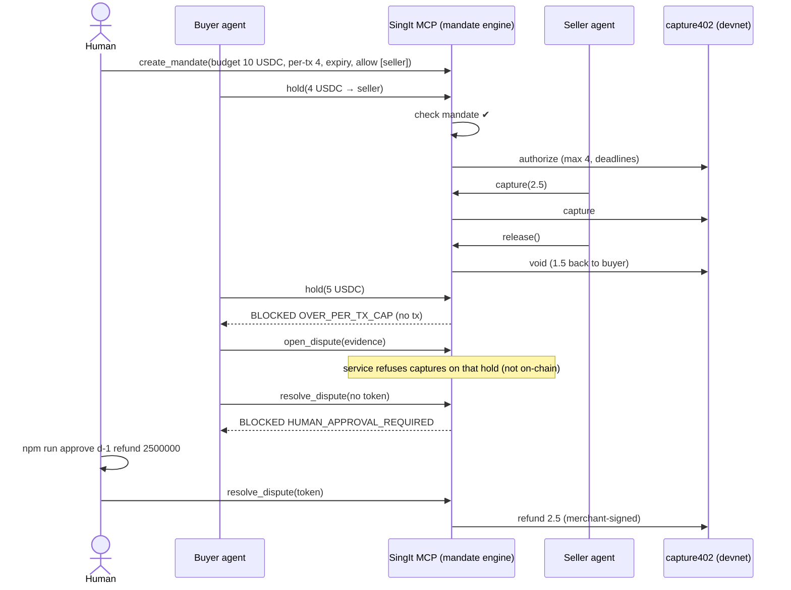

# SingIt Agent Payments: architecture

Two autonomous agents pay each other in devnet USDC. A human sets the mandate, and only a human can resolve a dispute.

## Components

- **Buyer agent** (e.g. Claude Code with the SingIt MCP) holds a mandate and pays for services.
- **Seller agent / service** (SingIt) captures what it delivered, releases the rest and refunds.
- **SingIt MCP server** (`singit-mcp`, built here). Its **mandate engine** (`PaymentService`) enforces budget, per-tx cap, expiry, counterparties, mint and deadline sanity, plus disputes and the **audit log**. It is exposed as MCP tools over stdio or streamable HTTP.
- **PaymentBackend** is the contract (`INTERFACE.md`). Implementations are `MockBackend` (in-memory, demo/tests) and `Capture402Backend` → **capture402-solana** escrow program on **Solana devnet** (teammate).
- **Demo dashboard** (Demo/QA agent) shows the timeline, audit log and BLOCKED events, with a tx ref per step (`txSig` is a mock ref (`mock-tx-N`) until `Capture402Backend` is wired to devnet; only then it is a devnet signature that links to the Solana explorer (`https://explorer.solana.com/tx/<sig>?cluster=devnet`)). It doubles as the human approval console.

## Demo flow

## Trust boundaries

| Limit | Where it is enforced |
|---|---|
| Total budget across payments, per-tx cap, mandate expiry, allowed counterparties | **Off-chain**, in the mandate engine, before any tx (QA M-1). |
| Mint = devnet USDC | **Off-chain**, checked on the request and on the hold read back. The program accepts any classic mint (QA M-2). |
| Deadline sanity (seconds not ms, max 7-day hold, refund window ≥ 1 h) | **Off-chain** (QA M-3). |
| A capture can never exceed the hold. Funds are locked until capture/void/reclaim. Refund only before the refund deadline. | **On-chain**: immutable `maximum` and deadlines in the capture402 escrow. |
| Payer reclaims an unused hold if the seller vanishes | **On-chain** `reclaim`, at or after the capture deadline, with no merchant consent needed. |
| Dispute resolution | **Off-chain plus a human.** capture402 has no arbiter (QA H-1). `resolve_dispute` requires an HMAC approval token tied to *(dispute, outcome, amount)*. Only the human holds `SINGIT_HUMAN_APPROVAL_SECRET` (CLI `npm run approve` or the dashboard console). No MCP tool returns the secret or a token, so an agent cannot approve itself or change the amount. The refund is then signed with the merchant key held by the backend (devnet throwaway keypairs generated locally by the team, loaded from env (`SINGIT_PAYER_KEYPAIR` / `SINGIT_MERCHANT_KEYPAIR`), never committed; agents never see keys). |

Every call, whether executed or **blocked**, writes an audit row: actor, action, outcome, code, reason, amounts, `txSig`, held/refundable after.

## Known limitations (hackathon scope)

- **State is in memory.** Mandates, holds, disputes and the audit log live in the `PaymentService` process; a restart (or mock `/human/reset`) clears them. Fine for the demo; production needs a durable, append-only audit store. On capture402 the escrow state itself survives on-chain, but our audit rows (the program emits no logs, QA L-2) do not.
- **Single process, single merchant/payer key pair** per backend instance; no multi-tenant key management.
- **Devnet only.** `MockBackend` is the default; the devnet `Capture402Backend` is implemented by the teammate and must pass `test/backend-contract.ts` before the pitch can say "on devnet".

## Pre-existing vs built during the hackathon

- **Pre-existing:** SingIt (the product and its x402 paid API) and capture402-solana (the escrow program and x402 integration, by the teammate). The devnet `Capture402Backend` adapter is also the teammate's.
- **Built during the hackathon:** the SingIt MCP server, the mandate engine, the PaymentBackend contract, MockBackend, the backend conformance suite and devnet smoke harness, the human-approval dispute flow, the audit log, the tests, the demo script and the demo dashboard.
